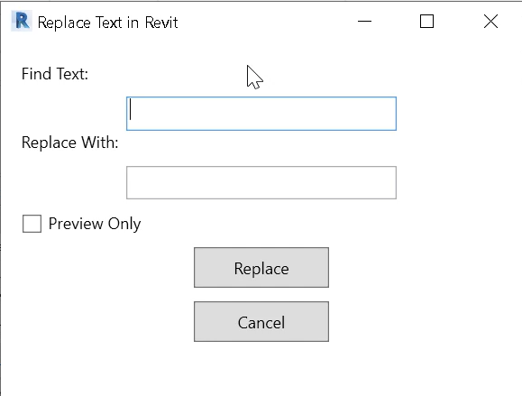

# Revit Find and Replace Text

A Revit add-in that searches view-associated text and string parameters and replaces matching text, with a preview-only mode.

## Compatibility

- Revit API target configured in the project: Revit 2022
- .NET Framework 4.8
- C# / WPF
- Solution: ViewsFindReplaceText/ViewsFindReplaceText.sln
- Project: ViewsFindReplaceText/ViewsFindReplaceText/ViewsFindReplaceText.csproj

The project references the Revit 2022 API from a local installation path. Other Revit versions need compatible references and testing.

## Features and options

| Control / feature | Behavior |
|---|---|
| **Find Text** | Required text fragment to search for. |
| **Replace With** | Replacement text. The current implementation requires this field to be non-empty. |
| **Preview Only** | Runs the search/replacement inside a Revit transaction, displays a change log, and rolls the transaction back rather than committing changes. |
| **Replace** | Executes preview or replacement according to the checkbox. |
| **Cancel** | Closes the dialog without running the command. |

### What is searched

The current source iterates valid views and checks view-associated elements, including:

- Text notes: replaces matching text in TextNote content.
- Independent tags: checks the tag's writable, populated **Comments** parameter.
- Family instances: checks writable, populated string parameters on family instances visible to the view collector.

The search uses a case-sensitive substring check and the standard string replacement behavior. It does not provide regular expressions, whole-word matching, case-insensitive matching, or a user-selectable view/category scope.

## Quick start

1. Open a test project in the supported Revit version.
2. Install the add-in and restart Revit.
3. Run **Replace Text in Revit**.
4. Enter a non-empty Find Text value and a non-empty Replace With value.
5. Enable **Preview Only** first.
6. Click **Replace** and review the preview log. Preview mode rolls back the transaction.
7. If the preview is correct, disable Preview Only and run Replace again.
8. Review the completion message and inspect representative views and family parameters.
9. Save the project only after validating the changes.

**Important:** the implementation can modify string parameters on family instances encountered in each view, not only visible label text. Review the preview log carefully and test on a copy before a large replacement.

## Build from source

1. Install Visual Studio with .NET desktop development and the .NET Framework 4.8 targeting pack.
2. Install Revit 2022.
3. Clone or download the repository.
4. Open ViewsFindReplaceText/ViewsFindReplaceText.sln.
5. Verify the RevitAPI.dll and RevitAPIUI.dll references in the project file point to your Revit installation.
6. Build the solution.
7. Locate the generated ViewsFindReplaceText.dll.

## Installation notes

The repository source includes the WPF window and command code. Confirm that a valid Revit .addin manifest exists and points to the built DLL; the current repository README and project listing should be checked for the intended manifest/deployment setup before installing.

For a manual per-user install, place the DLL and a correctly configured .addin manifest under:

**%APPDATA%\Autodesk\Revit\Addins\2022\**

Then restart Revit and verify the command appears. The manifest must use the exact installed DLL path and the correct external command class from the source.

## Troubleshooting

- **Command is missing:** verify the .addin manifest, assembly path, command class, and Revit version folder.
- **Build cannot resolve RevitAPI:** update the local API reference paths and confirm the matching Revit SDK/API is installed.
- **No changes are listed:** check spelling and case; the search is a case-sensitive substring match.
- **Preview seems to change the model:** preview mode is designed to roll back the transaction; verify the model after running and report any unexpected behavior.
- **A parameter is not changed:** it may be read-only, unset, non-string, or not collected in the current view.
- **Unexpected text changes:** use Preview Only first and test on a copy because the command scans multiple valid views and writable family-instance string parameters.

## Known limitations

- The current UI requires both the find and replacement fields to be non-empty, so replacing text with an empty string is not supported through this interface.
- Search is case-sensitive and based on substring matching.
- The current source does not expose a configurable category/view filter.
- Test thoroughly before using on production models.

## Source layout

- ReplaceTextWindow.xaml — WPF interface
- ReplaceTextWindow.xaml.cs — search, preview, replacement, and transaction logic
- Class1.cs — Revit command entry point
- ViewsFindReplaceText.csproj — framework and Revit API references
